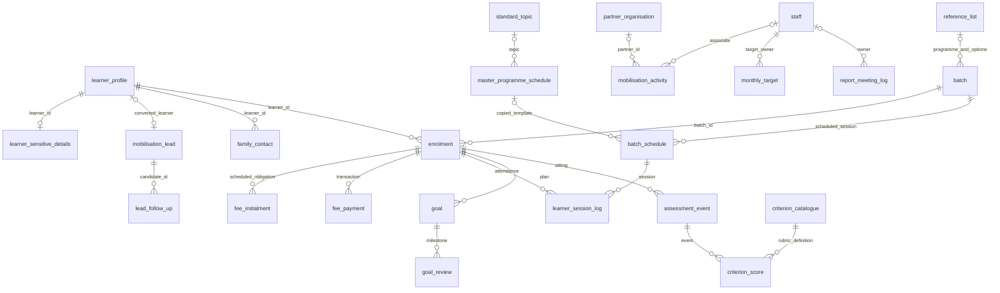

# Veruschka IDS model

## Status and authority

2026-11-13: Stage 3 is approved through opening a pull request only. The SQL has
not been applied to hosted Supabase and no source data has been loaded.
The allowed project is `uzofrrrtwqjmtytrbqfr`; every other project is out of scope.

Authority: detailed v3 diagrams.net model plus the user's Stage 2 decisions.
The Model Guide describes the same 24-table model at a higher level. Exact
types, nullability and FKs are in [fields.md](fields.md) and
[model-spec.json](model-spec.json). [er-diagram.mmd](er-diagram.mmd) is the
machine-readable ER diagram; a compact rendering is below.

The full ER file includes each individual FK, Auth links and audit actors.
Learner Sensitive Details has at most one row per learner; its PK/FK does not
force creation of a sensitive row for every learner. Leads may remain unlinked;
each non-null learner link is unique. Family Auth IDs are deliberately nonunique;
Staff Auth IDs are unique when present. No Auth accounts are created by this PR.

## Tables, fields and source routing

Each of the 23 numbered data tabs maps to its same-named snake_case table in
`ids`; `24.Reference List` maps to `ids.reference_list`. Model Guide is documentation,
not a domain table. [source-audit.json](source-audit.json) records exact tab names,
sheet IDs, headers, counts, checksums and exception row references without source
people, identifiers or sensitive cell values.

Four tables start empty: `goal`, `goal_review`, `assessment_event`, `criterion_score`.
No missing operational records are manufactured. All blank source values remain
null. Existing text business identifiers are retained exactly; generated examples
in the diagram are not used to regenerate source IDs. Names, email, phone and date
of birth are never identity-matching keys. `registration_no` is deliberately not
unique while its business definition remains unresolved.

`numeric` retains exact decimal values without an invented currency precision or
measurement unit. Text stays text for financial-year segments, phones, postcodes,
IQ, rubric versions and assessment numbers. Existing numeric assessment numbers
will be represented textually without inventing prefixes; their original numeric
type remains in the raw source-row payload. Family Contact and Staff Auth IDs use
UUID only when explicitly mapped. Gender, APL/BPL and quarter remain unrestricted
source text; unknown options are not silently added or relabelled.

### Approved diagram exceptions

| Item | Implemented decision |
|---|---|
| Converted leads | Retain them; unique non-null learner_id after a fresh read found zero repeated learner links |
| Aadhaar | NOT NULL and nonblank; all 215 fresh source rows have values; PAN remains nullable |
| Sensitive access | Ignore diagram's everyone-can-see note; keep all model/audit objects closed |
| Activity next date | Include nullable next_follow_up_date; source lacks the column, so import null |
| Enrolment documents | docs_provided boolean; retain four separate document checks and text remarks |
| Assessment session | batch_schedule_id nullable |
| Template reference | master_programme_schedule_id, never template_id |
| Session types | Nine actual Reference List options; no standalone Independent option; ignore stale FUNCTIONAL_AND_CULINARY |
| Lead next date | Preserve source follow_up_date; do not replace it from history |
| Fees | Preserve source gross fee, subsidy and each scheduled amount; derive balances/status; no transaction-to-instalment link |
| Timestamps | Future parser interprets source wall times as Asia/Kolkata; retain raw serial/display values and document workbook timezone conflict |

## Constraints and calculation rules

Primary keys and all diagram FKs are explicit and indexed. Reference fields also
check their list-name prefix, preventing a valid option from the wrong group.
Source `attendance_mark` remains P/A/PL/H/L; the generated `attendance_reference_id`
provides its FK without rewriting the raw mark. Additional `context_*` integrity
columns mirror parent keys, section and score limits; they are not source fields
or inferred business values. All domain tables have nullable `source_row_id` for import lineage;
null is permitted for invented local fixtures and later native application rows.

Composite uniqueness covers staff/month, learner/batch, enrolment/instalment number,
template/programme/week/session, batch/week/session, enrolment/session,
enrolment/goal number, goal/milestone, assessment-type/rubric/criterion-name and
assessment-event/criterion. Non-null structural components preserve the approved
record grain. Unknown business attributes remain nullable instead of guessing.

Composite foreign keys enforce contact ownership, enrolment/session batch context,
ILS goals, and event/criterion rubric matching. Private SECURITY INVOKER triggers
populate integrity context from the referenced parent, overwriting any supplied
context. The FK checks—not the trigger's snapshot—prove that it is still current.
Non-null context and CHECK constraints enforce section-specific ratings and score
ceilings. A null source maximum uses an internal Infinity ceiling; a null goal
section uses an internal empty key. Original source values remain null. These
sentinels prevent nullable composite keys from skipping the integrity check.

Parent reassignment does not silently cascade to children. A compatible change
requires an explicit transaction: defer the context FKs, update the parent, refresh
the affected children (e.g. SET goal_id=goal_id), then make constraints immediate
before commit. Invalid changes fail. This replaces the original whole-model
parent-scan trigger and is safe under PostgreSQL FK concurrency enforcement.

Used criterion definitions/scoring cannot be rewritten; create a new rubric
version instead. Source lineage and source audit timestamps/actors are explicitly
excluded from this definition comparison, so controlled provenance updates work.
The remaining definition-immutability existence check supports **READ COMMITTED**
only: an actual definition/scoring UPDATE at REPEATABLE READ, SERIALIZABLE or any
other level fails with SQLSTATE 0A000. Metadata-only updates remain allowed.
Score writes hold SHARE on the catalogue row until commit, so a waiting READ
COMMITTED definition update sees the committed use and fails. Two-session tests
exercise this race. Ordinary relational FK checks support READ COMMITTED and
REPEATABLE READ (a competing change fails with an FK/serialization error).
All functions retain fixed pg_catalog search_path and no API execution grants.

Goals apply to ILS. Review weeks are 4, 8, 12, 16, 20, 24; week 24 is the final
IFSP review, not a new endline assessment type. Numeric SMART ratings permit 1–4;
Functional/Hospitality permit 0–3; null is unassessed. Other sections' score
semantics remain open. SEED Other requires explanatory text. No calculation maps
text ratings to numeric scores or invents weighting rules.

Fee views run with security_invoker=true. `enrolment_fee_summary` exposes the
original gross fee/subsidy, SUM of scheduled source amounts as scheduled_net_due,
net payments minus refunds, balance, credit and last payment date. No source
net-due column exists: no new stored amount is fabricated from gross minus subsidy.
The observed equation matches all 220 source enrolments, but its interpretation
remains an open question. Absent obligations leave scheduled_net_due, balance and
credit NULL, including when a payment exists. `fee_instalment_balance` allocates net paid oldest due date first, then
instalment number/ID; null dates sort last. Excess is credit. Refunds are positive
transactions of Refund type. No per-instalment payment provenance is claimed.

## Authoritative reference options

[config/reference-options.json](../config/reference-options.json) contains all 154
approved option IDs, exact display labels, sort order and active flags across 52
lists. These are model configuration, not extracts of source people. The migration
creates the table but inserts no options or source rows. The local dummy seed uses
the configuration; a future approved source load must preserve actual source audit
timestamps and row lineage. PostgreSQL ENUM types are deliberately not used.

## Source lineage, exceptions and retries

`ids_import.import_run` holds the hardcoded allowed project, approved scope,
source timezone, file, run timestamps, status and baseline manifest.
`import_chunk` identifies bounded ranges and payload fingerprints with pending,
committed, failed or uncertain status. `source_row` retains original file/tab/sheet
ID/row, raw values, formatted values, SHA-256, disposition and target identity.
`validation_issue` stores warnings/errors by safe reason code and source row.
Source-file/run identity is a composite FK. If a source row has a chunk, a second
composite FK binds its chunk/run/sheet/first-row/last-row; a CHECK requires the
original row to lie within those copied bounds. A trigger fills bounds from the
actual chunk and cannot be bypassed by supplying different bounds. The FK also
prevents checkpoint sheet/range changes that would invalidate existing rows.
Unchunked staging rows remain permitted with null bounds; the future loader must
assign committed chunk membership before treating a row as checkpointed.
Every domain row links to its raw source row when imported; historical raw rows
remain separate across runs. `created_at`/`updated_at` are source audit times;
`recorded_at` and run timestamps are import times. They are not interchanged.

The future loader must enforce tab/range authorization, preserve checkpoints in
the same committed transaction as the corresponding records, and compare payload
fingerprints before treating a retry as already complete. An uncertain write must
be verified, not repeated. The schema supplies storage and uniqueness for this
protocol, not a working loader. Stage 4 implementation/trial remains unapproved.

Accounting: `considered = domain_loaded + staging_only + quarantined`;
`loaded_including_intentional_staging = domain_loaded + staging_only` gives the
requested `loaded + quarantined = considered`. Incomplete/null dispositions must
be zero before declaring a run complete. Warnings never change a loaded row to
quarantined. Reconcile destination counts by approved scope, not global totals.

## Access boundary

`ids` and `ids_import` must remain outside hosted Data API exposed schemas.
The local configuration also excludes them. SQL creates the schemas, revokes
schema/table/sequence/function privileges from PUBLIC, anon, authenticated and
service_role, and revokes default privileges for the migration owner in these
schemas. Every table has RLS enabled and zero policies. Views are private and
security invoker; there are no SECURITY DEFINER functions in the migration.
Owners/superusers can still access data: this is not an encryption boundary.
Schema-specific default revokes cannot cancel a pre-existing global default grant.
The migration therefore explicitly revokes all privileges on its actual objects
at the end of the same transaction. Every later object-creating migration must
repeat that explicit revoke and verification; do not rely on defaults alone.

An authorized future application must first verify the live Data API schema list
and refuse to proceed if either schema is exposed. Local config alone cannot
change or prove hosted exposure settings. Run grants/RLS/constraint/index checks
after any eventually approved application. Do not add a Data API grant or a
loader execution role under the present approval.

## Sensitive-field handling

Learner Sensitive Details stays separate for Aadhaar/PAN/UDID, disability,
medical conditions, medication and exact income. Learner Profile still contains
identity, address/contact and financial fields; Enrolment/Fee tables contain
financial and consent facts; Assessment Event includes IQ/height/weight and
family reports. Contacts, staff identity and free text can also be sensitive.
Keep all of them private; do not infer that only table 9 needs protection.

No raw extracts, CSVs, live person records, login mappings, keys or secret values
belong in Git. Future failure logs must contain only source file, row reference
and safe failure reason. No Google Sheet failure log is created in Stage 3.

## Verification and limitations

Run `python scripts/validate_local.py`. It applies migration files to a new isolated
PostgreSQL 17.11 container, loads only invented dummy records, verifies constraints,
fee behavior, approved exceptions, indexes, RLS and grants, then removes the container.
The image is pinned by digest. No host ports are published; no network is available
inside the container. The harness uses only the local Unix Docker socket and strips
Supabase/Postgres connection environment variables.

The local Auth fixture has only auth.users(id) and API role names. It is not the
full Supabase stack, PostgREST or hosted security advisors. No claim is made that
an unapplied schema has passed hosted advisors or API integration tests. The
actual worker's allowed-project read-only query passed during Stage 1; Stage 3
only made read-only hosted checks. See [handover.md](handover.md) for known issues.
